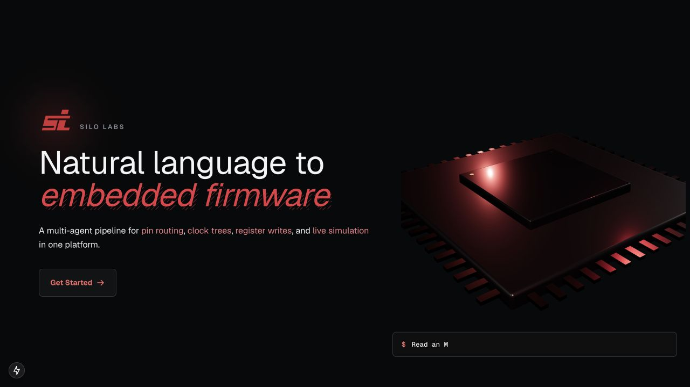
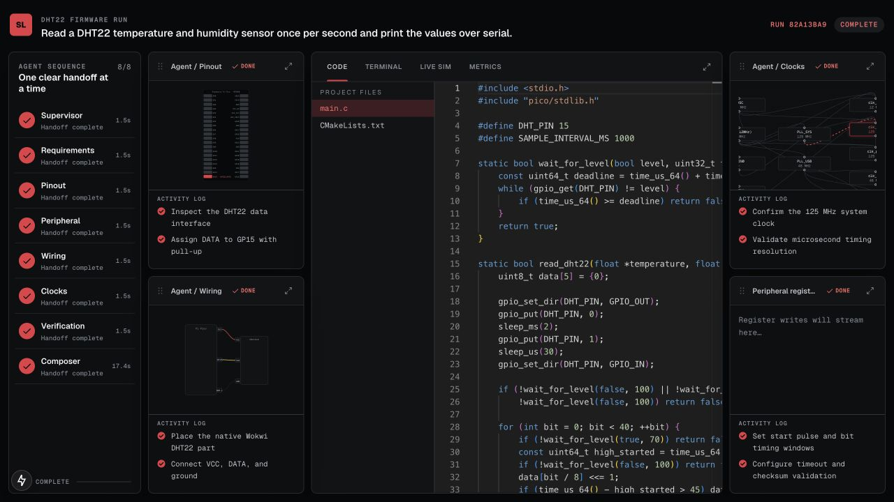
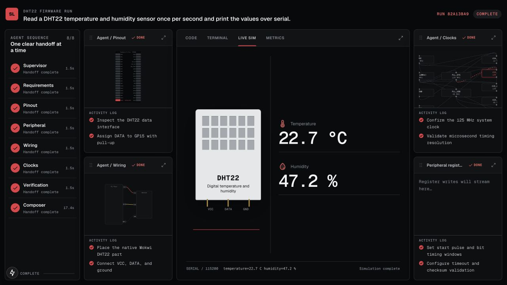
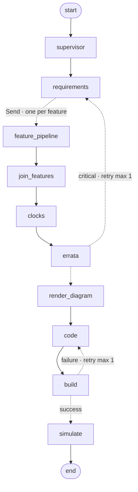

# Silo Labs

AI firmware generator for RP2040, STM32F103 and ESP32. Pick a target MCU and describe
what you want in natural language; a multi-agent LangGraph pipeline grounded by a ChromaDB
RAG index of 4.9K vendor register specs emits pin assignments, clock configuration, register
writes, wiring, C code, and a Wokwi simulation — live, streamed over SSE.

## Screenshots

The workspace screenshots show the local DHT22 demo and fixture simulation output.

### Landing page

Describe the firmware you want to build.



### Firmware workspace

Agent handoffs and the resulting C firmware in the demo workspace.



### Simulation output

The DHT22 demo with temperature, humidity and serial readings.



## Canonical demo

> Read a BME280 over I2C and display the readings on an SSD1306 OLED.

## Architecture

Multi-agent LangGraph pipeline. The diagram below is generated from
`pipeline.get_graph().draw_mermaid()` — it is the actual compiled graph, not a
hand-drawn approximation. A PNG fallback ([`docs/architecture.png`](docs/architecture.png))
is committed for renderers that don't support Mermaid.



Solid arrows are unconditional edges. Dashed arrows are conditional edges
(LangGraph routes through them based on state). The two retry edges are
budget-bound — `code_retries` and `errata_retries` cap each at one attempt.

### Nodes

| Node | Role | Model | Notes |
|---|---|---|---|
| `supervisor` | Decompose prompt into N parallel features | Sonnet 4.6 | Emits `RunPlan` (FeatureSpec list + rationale) |
| `requirements` | Parse to one canonical `Requirements` record | Sonnet 4.6 | Peripheral, device, intent, optional address/baud |
| `feature_pipeline` | One feature's pinout + peripheral config + wiring | Sonnet 4.6 | Runs in parallel — one branch per `FeatureSpec`, dispatched via `Send` |
| `join_features` | Merge per-feature outputs into top-level state | — | Custom dict reducer makes the parallel writes commutative |
| `clocks` | Configure oscillator / PLL / bus clocks for the target | Sonnet 4.6 | Domains validated against the MCU profile |
| `errata` | Errata cross-reference (hand-modeled for RP2040) | — | Critical workarounds loop back to `requirements` |
| `render_diagram` | Build the merged Wokwi `diagram.json` | — | Deterministic render of all per-feature wires |
| `code` | Generate multi-file project (drivers, headers, CMake, main.c) | Sonnet 4.6 | `MultiFileProject` schema, 12k token budget, build-stderr retry hint |
| `build` | cmake + ninja + arm-none-eabi-gcc (RP2040) | — | Failure feeds tail of stderr back into `code`; skipped for MCUs without a toolchain |
| `simulate` | `wokwi-cli` (live) or fixture replay | — | Streams serial via SSE; finalizes metrics |

### LangGraph features actually used

- Parallel fan-out via the `Send` API (one branch per feature)
- Custom reducer on `feature_outputs` so concurrent Send branches merge instead of clobber
- Conditional edges with bounded retries: `build → code` on failure, `errata → requirements` on critical workaround
- `RetryPolicy(max_attempts=2, backoff=2.0)` on every LLM-bearing node
- `MemorySaver` checkpointer keyed by `session_id`; resumable via `POST /api/sessions/{id}/resume` (one-line swap to `SqliteSaver` for production)
- `@instrumented` decorator captures per-node tokens / duration / cost; `parallel_speedup` derived from `sum(feature wall-clocks) / max(feature wall-clock)`

### Multi-MCU targets

`DesignState.target_mcu` selects an `McuProfile` (registry in `app.mcu`); the
landing page's picker and `?mcu=` on `/api/stream` choose it, and `/api/mcus`
lists them. The target is carried in a `ContextVar`, so schema validators
resolve register addresses, pin numbers (`PB7`, `GPIO21`, `GP4`) and clock
domains against the right chip.

| MCU | Board (Wokwi) | Framework | Build |
|---|---|---|---|
| `rp2040` | Raspberry Pi Pico | pico-sdk | arm-gcc → UF2, simulated |
| `stm32f103` | Blue Pill | CMSIS bare-metal | code only |
| `esp32` | ESP32 DevKitC V4 | ESP-IDF | code only |

Adding an MCU: drop `knowledge_data/<mcu>.svd` (+ optional
`knowledge_data/vendor_docs/<mcu>.md`), define an `McuProfile`, register it,
and rebuild the RAG index. No pipeline edits required.

The hardcoded DHT22 demo still replays for its exact prompt on RP2040.

### RAG grounding (ChromaDB)

`app/knowledge/rag.py` indexes every register of every CMSIS-SVD (address,
reset value, bit fields, descriptions — 4,901 registers across the three MCUs),
each section of the curated vendor notes (pin mux, clock tree, SDK idioms,
pitfalls) and the RP2040 errata into one persistent Chroma collection
(all-MiniLM-L6-v2 embeddings). The pinout, peripheral, clock and code agents
retrieve the top vendor-doc, errata and register chunks for their task,
filtered to the target MCU, and cite them by source. Register addresses
themselves are never taken from the model — the SVD graph still injects them.

```bash
cd backend && python -m app.knowledge.rag   # builds backend/.chroma (~1.5 min)
```

### Vendor-doc research

Agents bind LangChain `@tool` wrappers (`fetch_part_doc`, `fetch_url`) backed
by an httpx fetcher restricted to a curated allow-list of vendor hosts
(`docs.wokwi.com`, `raspberrypi.com`, Adafruit, Bosch, TI, ST, NXP,
Microchip, ARM). Results are cached on disk under
`~/.cache/silo-labs/research/`.

### Stack

- **Backend** (`backend/`): FastAPI · LangGraph 1.1 · Claude Sonnet 4.6 / Haiku 4.5 · Pydantic v2. Per-MCU knowledge graphs from CMSIS-SVD + ChromaDB RAG. `arm-none-eabi-gcc` + pico-sdk for builds. `wokwi-cli` for live simulation.
- **Frontend** (`frontend/`): Next.js 15 · React 19 · Tailwind 4 · Zustand store driven by typed SSE events. Monaco, xterm.js, @xyflow/react, Three.js, Framer Motion.

## Run locally

```bash
(cd backend && python -m app.knowledge.rag)   # once; docker compose mounts backend/
docker compose up
# backend:  http://localhost:8000
# frontend: http://localhost:3000
```

Environment (`backend/.env`):

```
ANTHROPIC_API_KEY=...
WOKWI_CLI_TOKEN=...   # optional; fixture used if absent
```

## Tests

```bash
cd backend && pytest tests/
cd frontend && npx tsc --noEmit
```

## Deploy

- Backend: build the RAG index locally, then `modal deploy backend/modal_app.py` (ships `backend/.chroma`)
- Frontend: `vercel --prod` from `frontend/`
